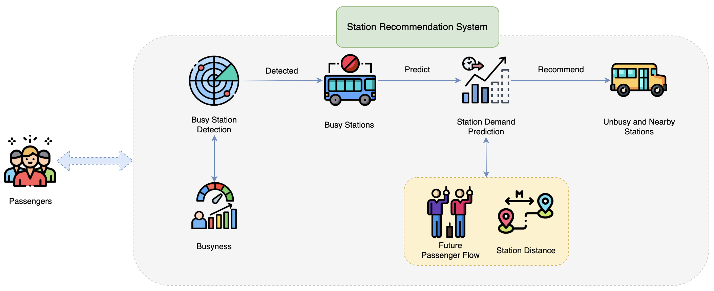
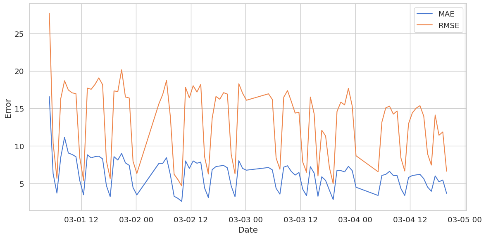
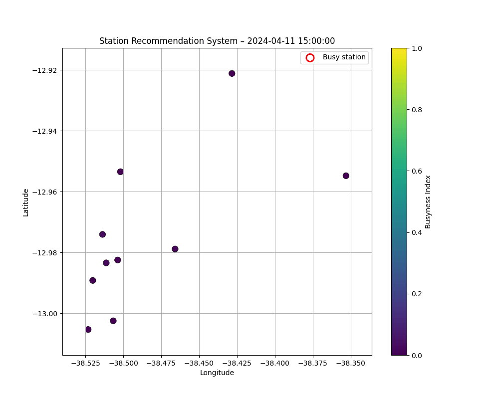

<div align="center">

# Streaming Transit Forecasting

### Predict passenger demand. Explore crowding. Recommend alternatives.

Academic team research on **online passenger-load forecasting** for ten bus stops in Salvador, Brazil.

**Python · CapyMOA · pandas · NumPy · scikit-learn · Jupyter**

[Paper](docs/paper.pdf) · [Experiments](notebooks/experiments.ipynb) · [Setup](docs/SETUP.md) · [Data](data/README.md) · [Team](#team)



</div>

## The project

Developed for **COMPX523-25A · Machine Learning for Data Streams**, University of Waikato, **2025**. The study predicts the average five-minute passenger load over the **next 30 minutes**, using observations from **ten stops** between March and May 2024.

The experiments compare autoregressive approaches, differencing, station/time encodings and contextual features with **KNN, FIMT-DD and Adaptive Random Forest** regressors. A prototype uses predicted crowding to suggest alternative stops.

The [paper](docs/paper.pdf) presents the study and its findings. [Reproduction checks](docs/REPRODUCIBILITY.md) cover the full model comparison, feature importances and recommendation examples.

## Research results

**All 25 experiment/model combinations in Table 2 have been reproduced. Every MAE and RMSE matches the precision published in the paper.** The [complete comparison](docs/results/table2-reproduction.csv) records the values for all 50 metrics.

| Approach | MAE | RMSE |
| --- | ---: | ---: |
| Naive baseline | 7.431 | 17.863 |
| Per-stop autoregression, variant 1 · KNN | 6.336 | 14.702 |
| Integrated model · FIMT-DD | 6.855 | 14.892 |
| **Seasonal integrated model · FIMT-DD** | **6.240** | **14.104** |

Adding time and station information improved the best reported model; adding the complete set of external variables did not improve it further. The full comparison and experimental assumptions are in the [paper](docs/paper.pdf).

## Visual overview

<table>
  <tr>
    <td align="center"><a href="docs/images/reported-error-over-time.png"></a></td>
    <td align="center"><a href="docs/images/station-busyness.gif"></a></td>
  </tr>
  <tr><td align="center">Error over time · original paper figure</td><td align="center">Station crowding · retained simulation output</td></tr>
</table>

The recommendation prototype assumes compatible bus routes and feasible walking between stops. It does not model actual walking routes or transfers.

## What is included

- The consolidated experiment notebook, with paths adapted to this folder structure.
- Historical transport-data exploration and earlier classification/recommendation prototypes, clearly separated from the main experiments.
- Original Python model and preprocessing scripts under `src/legacy/`.
- Selected aggregate transport/context data and stop coordinates, with [sources and attribution](data/README.md).
- The final academic paper, original figures and retained animation.

## Team

| Team member | Contributions |
| --- | --- |
| Aitana Cantó Rico | Conceptualization, analysis, investigation, methodology, software and original draft; development and evaluation of the station/hour time-aware baseline with FIMT-DD, KNN and Adaptive Random Forest. |
| Christopher Mayo | Conceptualization, data curation, analysis, investigation, methodology, software, validation, visualization and writing. |
| Ryan Manchester | Conceptualization, resources, software and presentation. |
| Bohui Zhong | Conceptualization, methodology, software, visualization and original draft. |
| Matthew Rolleston | Conceptualization, analysis, investigation, methodology, software and visualization. |
| Jayden Litolff | Conceptualization, data curation, analysis, investigation, methodology, project administration, software and visualization. |

The project was developed collaboratively by the team.

## Repository layout

```text
notebooks/
  experiments.ipynb       Main experiment and application notebook
  archive/                Earlier exploration and prototypes
src/legacy/               Retained Python models and preprocessing
data/
  raw/5min/               Aggregate transport observations
  raw/30min/              Aggregate inputs used by earlier prototypes
  processed/              Derived targets and contextual features
  reference/              Bus-stop coordinates
docs/
  paper.pdf               Submitted academic paper
  images/                 Paper figures and retained animation
  SETUP.md                Environment and notebook instructions
  REPRODUCIBILITY.md      Provenance, known issues and validation limits
scripts/check_project.py  Offline structural and data checks
outputs/                  Ignored local results
```

## Start here

To inspect the prepared files without installing ML dependencies:

```sh
python scripts/check_project.py
```

For the notebooks and full experiment runner, follow [local setup](docs/SETUP.md). The tested environment uses **CapyMOA 0.8.2**, Python 3.12 and Java 17. [Reproduction notes](docs/REPRODUCIBILITY.md) summarise the checks and evaluation limitations.

## References and reuse

The source study is **Autoregressive Modelling for Streaming Time Series Data**, COMPX523-25A Assignment 3, June 2025. Credit all six authors when describing its findings.

Transport observations derive from [SUNT](https://github.com/LabIA-UFBA/SUNT), [DOI: 10.17632/85fdtx3kr5.1](https://data.mendeley.com/datasets/85fdtx3kr5/1). Online models use [CapyMOA](https://capymoa.org/). See [data attribution](data/README.md) for dataset sources and reuse conditions.
